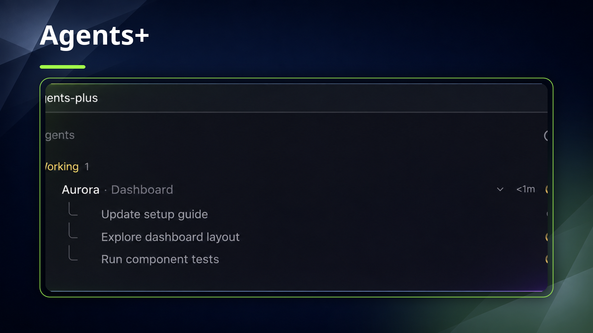
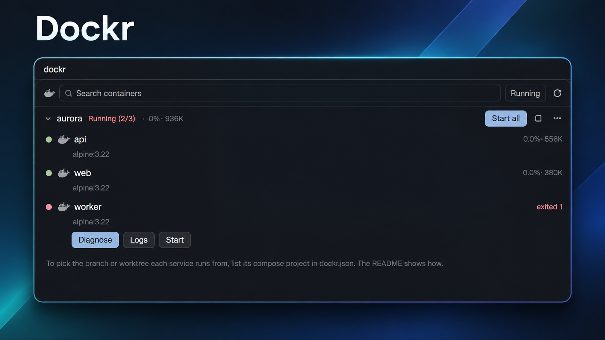
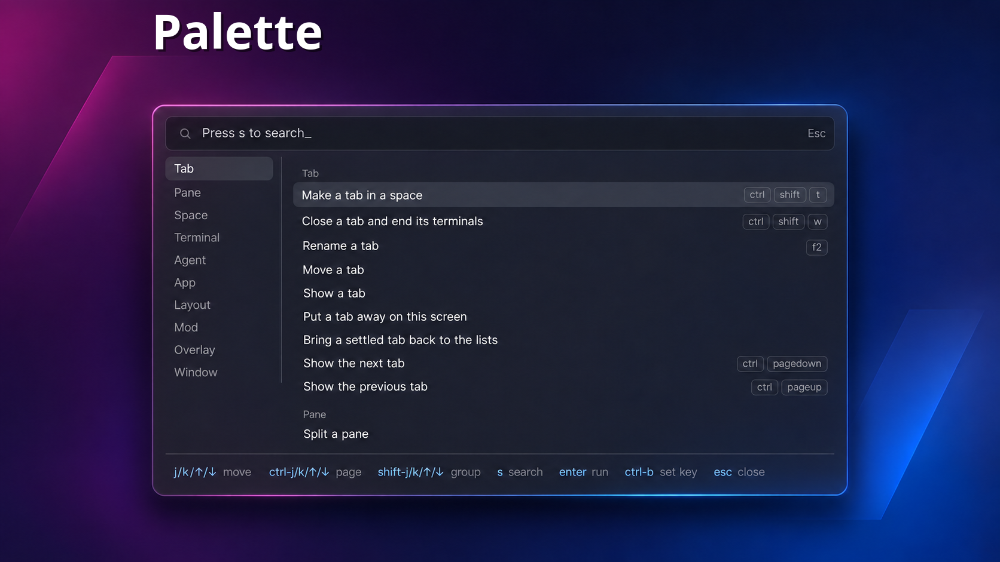
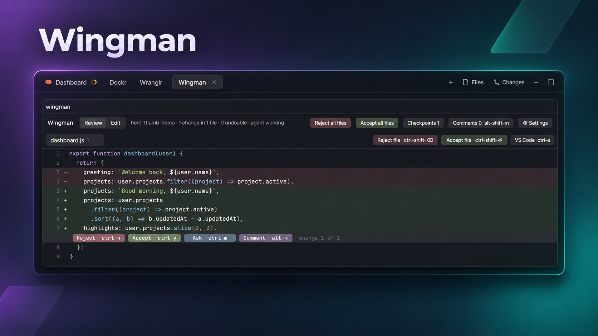
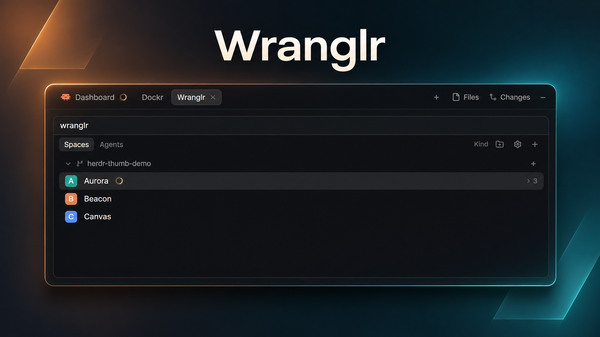

# herdr-mods

Mods for the [Herdr](https://herdr.dev) desktop app. Each folder is one mod, and its page says what it does, what it needs and how to install it.

<!-- shares:start -->
| | |
|---|---|
| [](agents-plus/) | **[agents-plus](agents-plus/)**<br>Herdr's Agents list with Claude Code's in-process subagents nested under the session that started them. |
| [](dockr/) | **[Dockr](dockr/)**<br>A dialog that lists Docker containers and sets which checkout each compose service runs from: the main checkout or a git worktree. |
| [](palette/) | **[Palette](palette/)**<br>A command palette that mods can add entries to: your entries, each mod's entries, then every Herdr command with its key. |
| [](wingman/) | **[Wingman](wingman/)**<br>A review pane for what coding agents change: whole-file diffs with Accept and Reject per change, per file or for everything. |
| [](wranglr/) | **[Wranglr](wranglr/)**<br>A spaces sidebar that sorts spaces into Groups: one per Repo, one per Workspace, and Custom groups you fill by hand. |
<!-- shares:end -->

## Install

Tell your agent, with the mod's folder name in place of `<mod>`:

```text
Read ~/.config/herdr-app/AGENTS.md, then add this mod: https://github.com/jbped/herdr-mods/tree/main/<mod>
```

Or follow the by-hand steps on the mod's page.

## License

MIT, see [`LICENSE`](LICENSE). A folder with its own license file keeps that license for the code it came with: `agents-plus` and `wranglr` started from Herdr's mods (Apache-2.0).
