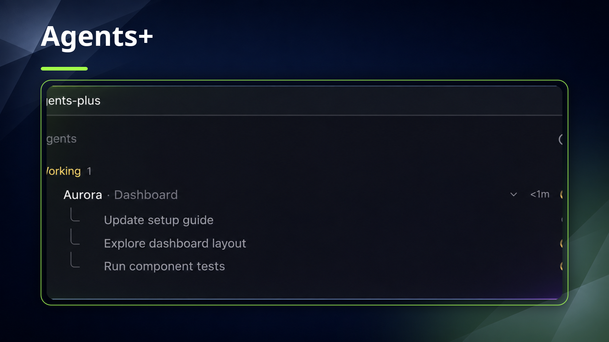

# agents-plus

Herdr's Agents list with Claude Code's in-process subagents nested under the session that started them.



## Features

- **Subagent rows.** Each in-process subagent (Claude Code's Agent tool) shows its description under its parent. Herdr's own list nests only subagents started with `hc run`.
- **Live state.** A spinner while the subagent works. The row goes when it finishes.
- **Click to open.** Click a subagent to open its view in its Claude Code session. Click the parent to go back to `main`.
- **Safe clicks.** It presses Enter only when Claude Code's screen shows the right subagent selected. Otherwise it shows a warning.
- **Palette entry.** With the `palette` mod, `Agents: Show or hide` toggles the list.
- **Every platform.** The same on macOS, Linux, Windows and Windows with agents in WSL, with no hook to install.

## Needs

- Claude Code, for the subagent rows and the click.
- It replaces the agents block in your layout.
- A click sends keys to the parent's Claude Code pane and reads its screen (`hc keys`, `hc read`). No network.
- It reads subagents from a Herdr field that is not documented yet, so a Herdr update could break it.

## Install

Tell your agent:

```text
Read ~/.config/herdr-app/AGENTS.md, then add this mod: https://github.com/jbped/herdr-mods/tree/main/agents-plus
```

Or by hand:

1. Copy `mods/agents-plus/` to `~/.config/herdr-app/mods/`.
2. In your own layout (clone a shipped one with `layout.clone`), set the agents block's `content.mod` to `agents-plus`.
3. Run `herdr-app check ~/.config/herdr-app/mods/agents-plus`.

## Use

The list works as Herdr's Agents list does. The subagent rows and the two clicks above are the only additions.

How it works and limits: [`mods/agents-plus/README.md`](mods/agents-plus/README.md). Modified from Herdr's `agents` mod (Apache-2.0, see `LICENSE`).
