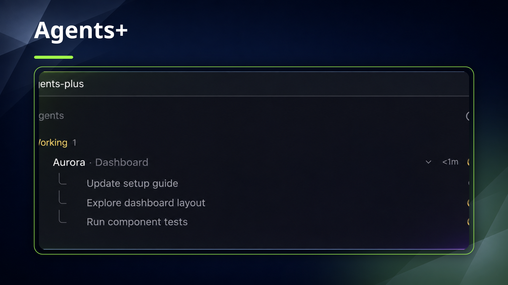

# agents-plus

Herdr's Agents list with one addition: the subagents an agent runs inside its own process (Claude Code's Agent tool) appear as rows nested under that agent. Each subagent row shows the subagent's description and its status. Clicking a Claude Code subagent opens that subagent's view in its Claude Code session, and clicking the parent agent goes back to the main view.

## What you see

The block fills the agents area of the sidebar, on `chrome` with a 1px `border` line on top. Everything except the subagent rows from `records` is the shipped `agents` mod's. Top to bottom:

- **Header**, 41px: "Agents" in 11.5px `dim`, and a 14px sort icon on the right.
- **Group headers**, 30px, 11px medium: "Pinned", then either the sections "Needs you", "Done", "Working", "Idle" (Priority sort, each with its count, colored `blocked`, `done`, `working` or `dim`) or one header per space (Grouped by space).
- **Agent rows**, 30px, radius 8, 13px text, on `selected` when focused. Left to right: the program's 16px icon, the name with "· detail" in `dim`, the machine name in 10px `dim` for an agent on another machine, a fold chevron when it has subagents, the time since its status last changed in 11px `dim` (`<1m`, `5m`, `3h`, `2d`), and the status mark. On hover a 13px pin button replaces the time.
- **Subagent rows** (added), 26px, radius 8, 12.5px text, indented 39px. Left to right:
  - tree lines, 9px wide, 1.5px in `input`, with a rounded corner into each row.
  - the parent program's icon at 14px.
  - the subagent's title in `muted`, cut off with an ellipsis. Without a title it shows the record's id.
  - the status mark.
- With no agents: "No agent status yet. Agents show up here when they report their status. Older versions and agents inside tmux may not." in 12px `dim`.

Status marks:

- working: a 12px spinner in `working`, one turn per 900 ms.
- blocked: a "Needs you" pill, 18px high, 10.5px semibold `blocked` text on `blocked` at 15% opacity. Under a "Needs you" header and on subagent rows in Priority sort it is a 14px square with "!".
- done: a 7px dot in `done`.
- idle: a 7px ring, 1.5px, in `idle`.

When the sidebar is narrower than 160px the block is a rail: 26px rows with the agent's number and status mark, no header, no subagent rows, and a "»" button at the bottom that widens the sidebar.

## How it behaves

Added by this mod:

- A subagent row exists for each entry in its parent terminal's `records` while the parent is live. A record with no state counts as working. `error` shows as blocked and `done` shows as idle.
- A parent takes the place of its most urgent subagent: blocked, then done, then working, then idle. In Priority sort a parent with a blocked subagent sits under "Needs you".
- Clicking a Claude Code subagent row focuses the parent's pane and switches that Claude Code session to the subagent's view.
- Clicking a subagent row of any other program focuses the parent's pane.
- Clicking an agent row focuses its pane. If its Claude Code session shows a subagent's view, it switches back to `main`.
- When the switch cannot be made, a warning notification titled "Couldn't open subagent" shows for 4 s. Its text is one of "<title> isn't in Claude Code's agent list.", "Couldn't reach Claude Code's agent list.", "Claude Code didn't switch views." or "The selection didn't land on the row."

From the shipped mod:

- The sort icon opens a 200×140 popup titled "Sort agents" with "Priority" and "Grouped by space". The choice applies to every copy of the list.
- Priority sort orders agents by urgency, then by the most recent status change. Pinned agents come first under "Pinned" in both sorts.
- A done agent you are looking at becomes idle but stays under "Done" until you focus another agent.
- Clicking a group header folds the group. Folded, it shows its count and a chevron, and in Grouped by space the most urgent status of its agents.
- The chevron on an agent row, or the agent's icon, folds its subagents. Folded, the chevron shows the subagent count in the color of the most urgent one.
- The pin button pins or unpins the agent. Its tooltip reads "Pin to the top" or "Unpin".
- Clicking a subagent started with `hc run` opens a peek at its terminal.
- Rows and headers have a `hover` state. Times refresh every 30 s.

## Built from

- `mods/agents-plus/mod.json`: `{ "place": "none", "title": "Agents", "cloned_from": { "name": "agents", "version": "0.1.13" } }`.
- `mods/agents-plus/main.js`: a `mod.clone` of Herdr's shipped `agents` mod at 0.1.13, with the additions below. One `props` role: `sortMenu: true` draws the sort popup, which the mod opens on itself with `openOverlay({ mod: "agents-plus", kind: "popup", width: 200, height: 140, props: { sortMenu: true } })`.
- `mods/agents-plus/README.md`: install steps, how it works, limits.
- `LICENSE` in the share: Apache-2.0. The mod is modified from Herdr's `agents` mod under that license, and the README states the changes.
- No layout ships with it. The person sets their agents block's `content.mod` to `agents-plus` in a layout of their own.
- Additions to the clone:
  - `recordKids`: for each live terminal from `terminals()` with a `records` object (`{ <id>: { app, state, title } }`), one row per record with `address: "rec:<terminal>:<id>"`, `parent: <terminal>`, `status: state || "working"`, `name: title || id`, the parent's `program`, and the record ids in order. These rows are appended to the terminal list before the shipped tree code runs, so nesting, folding and urgency work unchanged.
  - `footerRows`: parses the last 40 lines of a terminal's text for Claude Code's agent list. A row matches `^(❯ |  )([●◯]) (.+)$`. `❯` means selected, `●` means the view on screen, and the text before the first run of two or more spaces is the type, or `main`.
  - `openClaude`: picks the target row. It is the one non-`main` row whose text contains the first 24 characters of the record's title. If none or several match, it is the row at the record's position, used only when the footer lists as many subagents as `records` has.
  - `backToMain`: reads the footer and navigates to the `main` row only when a footer exists and `main` is not the view on screen.
  - `navigate`: focuses the pane, reads the footer, and returns if the target is already on screen. With no row selected it sends `down` (row count + 4) times in one call. Then, up to 4 rounds: it sends `up` or `down` by the distance to the target, rereads until the selection moves (up to 6 reads, 40 ms then 60 ms apart), and sends `enter` only when the selected row is the target. After `enter` it rereads up to 8 times, 80 ms apart, until the target shows `●`. One navigation runs at a time.
  - The subagent row's click: `openClaude` when `record.app` is `claude-code`, `pane.focus` on the parent for other records, `terminal.peek` for rows without a record.
- Herdr functions: `agents`, `terminals`, `panes`, `focused`, `spaces`, `layout`, `window`, `theme`, `props`, `run`, `shared`, `setShared`, `setAgentOrder`, `openOverlay`, `closeOverlay`, and the two added ones, `hc` and `notify`.
- Other built-ins: `localStorage` (keys `changed` and `pins`), `cx.timer.every`, `cx.spawn`, `cx.sleep`.
- Commands: `pane.focus`, `terminal.peek`, `terminal.pin`, `layout.resize`.
- `shared` keys: `agents.sort`, `sidebar.width`, `sidebar.collapsed`.
- Programs: `hc` only, through `hc(["read", <terminal>])` and `hc(["keys", <terminal>, ...keys])` with the keys `down`, `up` and `enter`. No `exec`. Network: none.
- Files read or written outside its folder: none.
- Art: from the shipped `workspace-chrome` mod, `clock.svg`, `layers.svg`, `check.svg`, `spinner.svg`, `chevron-down.svg`, `chevron-right.svg`, `pin.svg` and `pin-off.svg` under `mods/workspace-chrome/`. Agent icons come from each terminal's `program.icon`. Theme tokens only.

## Watch out

- `records` is not in Herdr's documentation. A Herdr update could rename or remove it, and the subagent rows would then be missing without an error.
- The click depends on how Claude Code draws its footer agent list. If that changes, the click ends in a warning. It never sends `enter` unless the screen shows the target row selected.
- With no row selected the mod sends `down` before it can tell whether the target exists. In a session without a footer list those keys reach the prompt.
- `up` is sent only while a footer row is selected, so it never walks the prompt history.
- The footer shows a subagent's description only until the subagent reports activity. After that the click goes by position, and when the footer and `records` differ in length it warns instead.
- Every click on an agent row runs one `hc read` on that terminal, whatever program it runs.
- A subagent row's address (`rec:…`) is not a terminal. Do not pass it to `terminal.peek` or `pane.focus`.
- The sort popup must open `agents-plus`, not `agents`. Rename it there too if the folder is renamed.
- The clone is of `agents` 0.1.13 and is never updated. A clone of a newer `agents` brings that version's list. Apply the additions to it and keep `cloned_from`.
- Subagent rows are not drawn in the rail.
- It needs the shipped `workspace-chrome` mod for its icons.
- Keep `LICENSE` and the statement of changes with any copy you share.

## Done when

- `herdr-app check ~/.config/herdr-app/mods/agents-plus` passes.
- With the agents block's `content.mod` set to `agents-plus`, the list shows the same agents, sort popup, pins and folds as Herdr's Agents list.
- While a Claude Code session runs a subagent with the description "Check the build log", a row "Check the build log" with a spinner appears under that session's row, joined by a tree line.
- Folding the parent hides the row and shows the count 1 beside the chevron.
- Clicking the subagent row focuses the parent's pane, and Claude Code shows that subagent's view.
- Clicking the parent row returns Claude Code to its main view.
- Clicking a subagent row whose footer row cannot be found shows the "Couldn't open subagent" warning, and no `enter` is sent.
