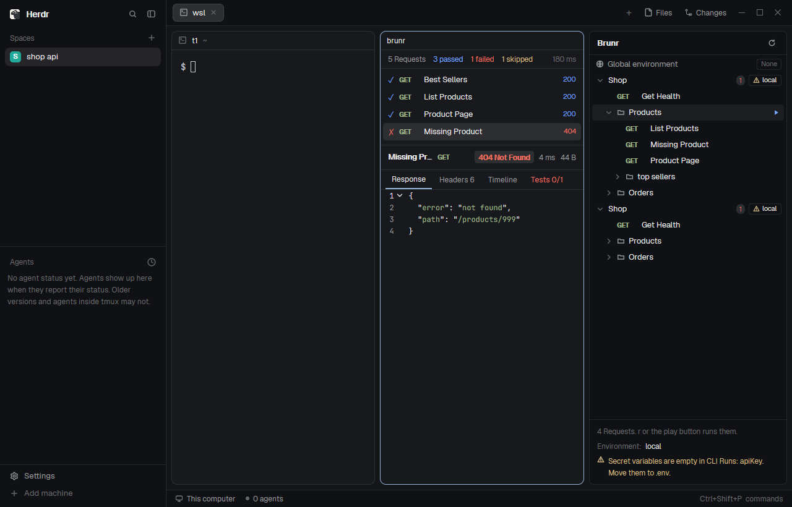

# Brunr

A side panel that lists your Bruno Collections as a tree, runs their Requests with the Bruno CLI and shows each Response in a pane.



## Features

- **Collection tree.** Collections, folders and Requests in Bruno's sidebar order, with method badges in the Herdr theme's colours. A selected Request shows its method and URL, and a change to a Collection on this computer shows at once.
- **Run a Request.** Double-click or press `enter`. The Response opens in a pane beside your terminal with its Response, Headers, Timeline and Tests views.
- **Folder and Collection Runs.** After a confirmation, with a summary line, a pass or fail mark per Request and the first failure selected. Assertion and test results are listed under Tests.
- **Environments.** Pick one per Collection from a chip on its row. The choice is remembered, and an Environment with secret variables carries a warning.
- **Global environments.** Pick one per Bruno workspace for all of its Collections.
- **Other Machines.** A Collection on WSL or an ssh Machine is listed and run there. Machines get their own headings.
- **Both formats.** The OpenCollection YAML format and the bru format, in one tree.
- **Open file and Open Bruno.** Show a Request's file in the pane, or start Bruno desktop.
- **Keyboard.** One key shows the panel and gives it the keyboard. Move, fold, run and pick without the mouse.
- **Setup help.** When `bru` is missing on a Machine, the panel says what to install and has a Copy button.

## Needs

- Herdr.
- The Bruno CLI (`npm i -g @usebruno/cli`, which needs Node 18 or later) on every Machine that holds a Collection.
- Bruno desktop is optional. Its workspace file is where Collections on this computer are found.
- It runs `bru`, `node --version` and a file-listing command (`sh`, or `powershell` on Windows) on a Collection's Machine. On another Machine it also runs `cat` and `rm`. Open Bruno starts the desktop app.
- It reads Collection files, Bruno desktop's `workspace.yml` and `brunr.json`. It writes a temporary report file per Run and deletes it. It never reads `.env`.
- A Run sends the Collection's requests to whatever they point at.

## Install

Tell your agent:

```text
Read ~/.config/herdr-app/AGENTS.md, then add this mod: https://github.com/jbped/herdr-mods/tree/main/brunr
```

Or by hand:

1. Copy `mods/brunr/` to `~/.config/herdr-app/mods/`.
2. Merge `keys.json` into `~/.config/herdr-app/keys.json`. It binds `ctrl-shift-u`.
3. The panel is shown and hidden by its block id, so add this block to your own layout. It goes in the row that holds the tab block, on the right:
   `{ "id": "brunr", "type": "block", "content": { "mod": "brunr" }, "size": { "px": 320 } }`
4. Run `herdr-app check ~/.config/herdr-app/mods/brunr`.

## Use

`ctrl-shift-u` shows the panel and gives it the keyboard. Click selects a row and double-click runs a Request or folds a folder. Right-click opens a row's menu, the play button runs a folder or Collection, and the chip on a Collection picks its Environment.

| Key | Action |
|---|---|
| `up` / `down`, or `k` / `j` | move |
| `left` / `right` | fold / unfold |
| `enter` | run a Request, or fold a folder |
| `r` | run the Request, folder or Collection |
| `e` | pick the Environment |
| `o` | open the Request's file |
| `escape` or `q` | hand the keyboard back to your pane |

Collections on other Machines need `brunr.json`. The config file, every key, secrets, Runs, limits and how it works: [`mods/brunr/README.md`](mods/brunr/README.md).
