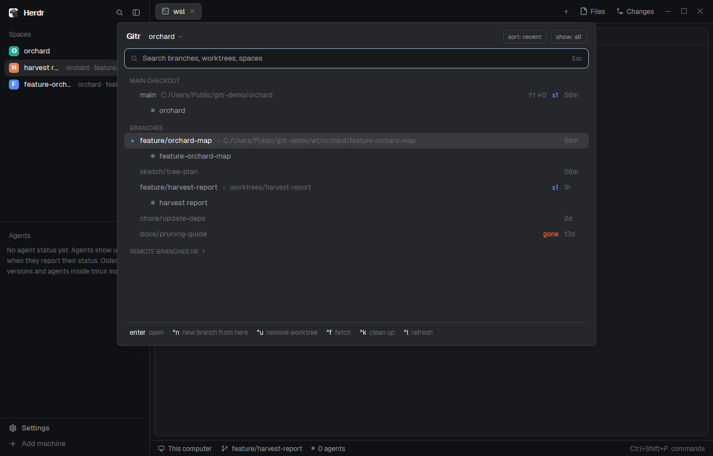

# Gitr

One Repo at a glance: its Main checkout, Worktrees and Branches, the spaces on each, and one key to go to, start or clean up work.



## Features

- **The whole Repo.** The Main checkout, then every local Branch on one row each, with ahead and behind, uncommitted changes, a gone upstream, a prunable Worktree and the last commit's age.
- **Spaces on their checkouts.** Each space shows under the Main checkout or Worktree it is in, with its agent status. Enter goes to it.
- **Start work.** Enter on a Branch gives it a Worktree and a space, or checks it out in the Main checkout. A remote branch gets a tracking Branch first.
- **New Branches.** Type a name that no Branch has and pick Create, or branch off any row. A new Branch starts from the remote's default branch, fetched first.
- **Safe checkout.** Checking out in a Main checkout with changes offers to stash, check out and reapply them, and asks first when a space is in it.
- **Remove a Worktree.** One question names the spaces it closes, the panes left inside it and the changes lost, and offers to delete the Branch too.
- **Clean up.** One checklist of Branches whose upstream is gone and Worktrees whose directory is missing. Work in progress starts unticked.
- **Delete, rename, fetch.** Delete asks again when git says a Branch is not merged. Fetch prunes.
- **Search, sort, filter.** Search Branches, Worktree directories and spaces. Sort by recent or A to Z. Show all Branches, those with a Worktree or those checked out nowhere.
- **Repos and Machines.** Switch to another Repo or to the same Repo on another Machine. An unreachable Machine shows its last known list.
- **Wranglr aware.** With Wranglr in the layout, Repos, new spaces and new Worktrees go through Wranglr's Groups and rules.

## Needs

- Herdr and git. Wranglr is optional.
- It runs git in the Repo on the Repo's Machine. Without Wranglr it starts spaces with `space.new` and makes Worktrees with Herdr's `worktree` dialog.
- It reads `~/.config/herdr-app/gitr.json` and writes `~/.config/herdr-app/data/gitr/state.json`.
- No network other than `git fetch`.

## Install

Tell your agent:

```text
Read ~/.config/herdr-app/AGENTS.md, then add this mod: https://github.com/jbped/herdr-mods/tree/main/gitr
```

Or by hand:

1. Copy `mods/gitr/` to `~/.config/herdr-app/mods/`.
2. Merge `keys.json` into `~/.config/herdr-app/keys.json`. It binds `alt-shift-g`.
3. Run `herdr-app check ~/.config/herdr-app/mods/gitr`.

## Use

Press `alt-shift-g` or pick "Gitr: Open" in the palette. It opens on the focused space's Repo. Type to search. Click a row to select it and click it again to run it. The footer shows what each key does on the selected row, and each item there is clickable.

| Key | Action |
|---|---|
| `alt-shift-g` | open or close |
| `up` / `down` | move |
| `enter` | go to the space, open the checkout, or start work on the Branch |
| `ctrl-o` / `ctrl-w` | check out in the Main checkout / Worktree and space |
| `ctrl-n` | new Branch from here |
| `ctrl-u` | remove the Worktree |
| `ctrl-k` | clean up |
| `escape` | close a question, clear the search, close |

Every key, the row marks, each action, settings, stored state and limits: [`mods/gitr/README.md`](mods/gitr/README.md).
