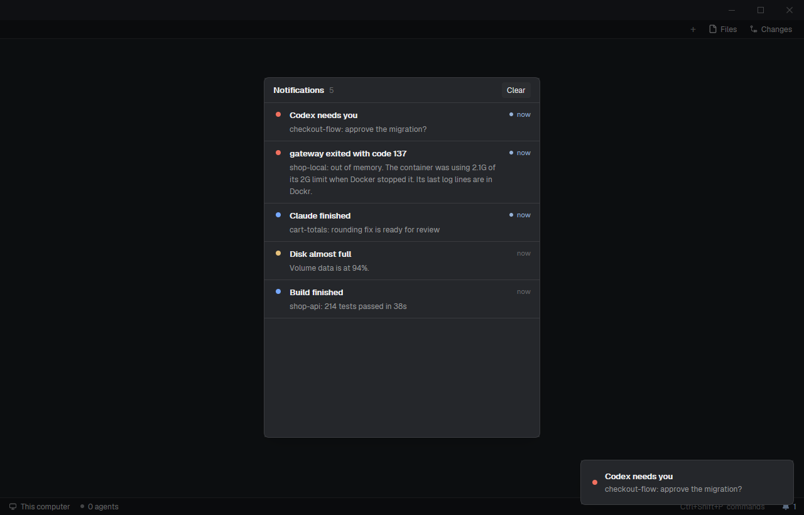

# Notifyr

A log of every notification Herdr shows. Toasts look as they always did, a bell in the layout counts the ones that arrived since you last looked, and a dialog lists the last 200 with their whole text. Clicking an entry runs what its toast would have run.

## What you see

- **Toast**: Herdr's own, unchanged. A row on `popover` with 18px side padding and a 12px gap: an 8px level dot (or an 18px icon), a 13px semibold title in `foreground` and a 12px one-line body in `muted`, both truncated. A machine login notice shows the command and a "Copy" button on `raised`.
- **Bell**: a block the person places, 48px wide in a 28px status row. A 14px bell icon, centered, in `muted` on `chrome` with a 1px top border in `border`. With unread entries the icon and an 11.8px count beside it are `accent`. The count stops at "99+".
- **List**: a dialog 440px wide and 70% of the window high, on `popover`.
  - Header, 40px with a bottom border: "Notifications" in 13px semibold, the entry count in 11.5px `dim`, and a "Clear" button on `raised` at the right when there are entries.
  - A warning line in 11.5px `working`, only when the shown layout's root does not name `notifyr` as its toast mod.
  - Rows, newest first, the only part that scrolls. Each has 14px side and 9px vertical padding and a bottom border: the 8px level dot or the toast's icon, the title in 13px semibold, the whole body wrapped in 12px `muted`, and the time at the right in 11px `dim`.
  - An unread row has a 6px `accent` dot before the time and the time in `accent`.
  - Empty: "No notifications yet." centered in `dim`.

## How it behaves

- Level colors: error is `blocked`, warning is `working`, success is `done`, info is `accent`. Herdr's agent notices arrive as toasts like any other, so "needs you" and "finished" are entries too.
- A toast is recorded when it appears, with the time taken then. Clicking the toast runs its action and dismisses it, as before.
- The bell counts entries newer than the last time the list was opened or closed. A click opens the list.
- `ctrl-shift-i` opens the list. Again closes it, and so does `escape`.
- Opening the list marks everything read. Entries that were unread at that moment keep their mark until it closes.
- A row whose toast had an action shows a pointer and a `hover` background. A click closes the list and runs the command.
- The time reads "now", "5m", "3h", then "Nov 16". Its tooltip is `2026-11-16 14:02`.
- "Clear" empties the record.

## Built from

- One mod, `notifyr`, with `mod.json` `{ "place": "none", "overlay": { "kind": "dialog", "width": 440, "height": 0.7 } }`. The view is chosen in `init` from `props()`: `bell` for the bell, a `title`, `body` or `level` for a toast, otherwise the list.
- The layout: `"toast": "notifyr"` on the root, and a block `{ "mod": "notifyr", "props": { "bell": true } }`. `"bare": true` drops the bell's background and border.
- `herdr` functions: `props`, `shared`, `setShared`, `run`, `closeOverlay`, `layout`, `theme`, `checking`. Commands: `mod.open`, and whatever each stored action names.
- Shared values: `notifyr.log` (`[{ id, at, overlay, title, body, level, icon, action }]`, newest first, 200 at most, body cut at 600 characters) and `notifyr.seen` (a time in milliseconds).
- The toast view is a copy of Herdr's `toast` mod.
- Art: `bell.svg`, one filled 16px glyph, drawn with `svg("mods/notifyr/bell.svg")`.
- `keys.json`: `"ctrl-shift-i": "mod.open:notifyr"`.

## Watch out

- There is no API for notifications. Being the toast mod is the only way to see them, so nothing is recorded on a layout that does not name this mod, and Herdr's shipped layouts cannot be edited to name it.
- Toast props carry no time and no stable id. Take the time in `init`. A hot reload starts an open toast's copy again, so skip an entry with the same `overlay` and title from the last minute.
- `init` runs during `herdr-app check`. Return before recording or writing shared values when `checking()` is true.
- The `overlay` size in `mod.json` applies to `mod.open` only. Herdr still sizes the toast.
- `raised` is too close to `popover` to mark an unread row by its background. Use the `accent` dot.
- The list is a centered dialog. A popup at the bell was not built.
- No keyboard navigation in the list.

## Done when

- `herdr-app check` passes.
- A `notify()` with a long body shows a truncated toast, and the list shows the whole body.
- The bell shows the count of new entries, and it clears when the list opens.
- `shared.json` holds the entries under `notifyr.log` after a toast.
- Clicking an entry with an action runs it. Clear empties the list.
