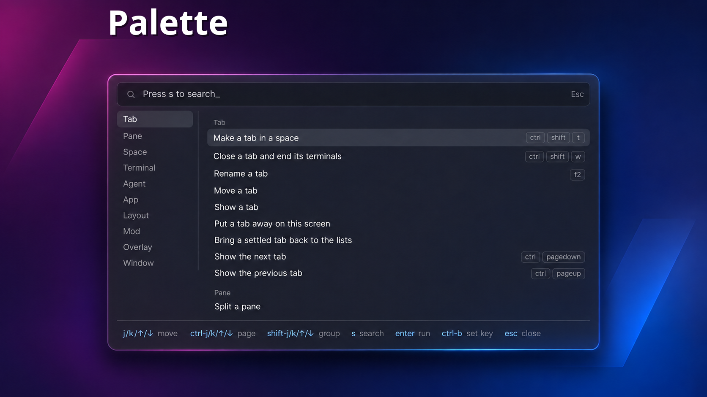

# Palette

A command palette that mods can add entries to: your entries, each mod's entries, then every Herdr command with its key.



## Features

- Your own entries from `~/.config/herdr-app/palette.json`, listed first.
- A mod adds entries with a `palette` list in its `mod.json`. The other mods in this repo do.
- Every Herdr app command, grouped as Herdr groups them, with its key from `keys.json`.
- Type to filter, and jump between groups from the sidebar.
- A command with required arguments asks for them before it runs.

## Needs

- Herdr only.
- It reads `palette.json`, `keys.json` and each mod's `mod.json`. It runs no programs and uses no network.

## Install

Tell your agent:

```text
Read ~/.config/herdr-app/AGENTS.md, then add this mod: https://github.com/jbped/herdr-mods/tree/main/palette
```

Or by hand:

1. Copy `mods/palette/` to `~/.config/herdr-app/mods/`.
2. Merge `keys.json` into `~/.config/herdr-app/keys.json`. It binds `ctrl-shift-p`, which replaces Herdr's palette. Herdr's stays in the list as `app.palette`.
3. Run `herdr-app check ~/.config/herdr-app/mods/palette`.

Keys and the entry format: [`mods/palette/README.md`](mods/palette/README.md).
