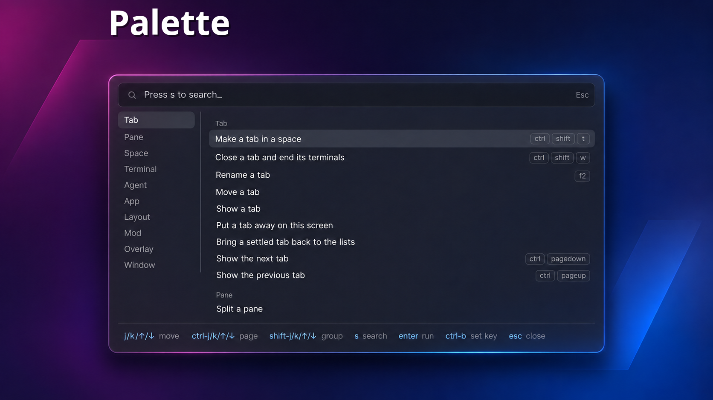

# Palette

A command palette that opens as a popup at the top of the window. It lists your own entries under Custom, then the entries other mods declare under Mods, then every Herdr command in groups (Tab, Pane, Space and so on), each with the key bound to it. You type to filter, pick a row and it runs. A command that needs arguments asks for them in the same box first.



## What you see

A popup 760px wide on `popover`, with 12px padding and a 6px gap between its parts. Top to bottom:

- **Search box**, 36px high, radius 8, a 1px `accent` border on `background`. Left to right: a 14px search icon in `dim`, the text field (12.8px, `foreground`, placeholder "Type a command…"), and "Esc" in 11px `dim`.
- **Group index**, a 120px column on the left with a 1px `border` line on its right. One 24px label per group that has rows, 12px text, radius 5. The selected row's group is `foreground` on `hover`. The others are `dim`.
- **List**, right of the index, at most 360px high. It holds:
  - group headings, 26px high, 11px `dim`.
  - rows, 32px high. Each row is a 28px pill with radius 6, and the selected one is on `hover`. Left to right: the title in 13px (`foreground` when selected, `muted` otherwise, cut off with an ellipsis), the mod's folder name in 11px `dim` on a mod's entry, and the key as keycaps.
  - keycaps: one box per part of the key (`ctrl-shift-t` draws `ctrl`, `shift`, `t`), 18px high, at least 18px wide, radius 4, a 1px `border` outline, 10.5px `dim` text, 3px apart.
- With no match, the index and list give way to "No matching command" in 12px `dim`.

Group order: Custom, Mods, then Tab, Pane, Space, Terminal, Agent, App, Layout, Mod, Overlay, Window, then any other command prefix in alphabetical order. Inside a group, commands keep the order Herdr reports them in.

A Herdr command's title is the first clause of its description. A command whose first clause is longer than 60 characters or does not start with a capital letter shows its command name instead.

While it asks for arguments, the index and list are replaced by:

- the search box, now showing the command's title and "›" in 12.8px `muted` before a field with the placeholder `Value, or {"name": value, …}`.
- a 12px `muted` line: the command name, then its argument names, each optional one marked "(optional)".
- a 12px `dim` line with the command's description, or an error in `ansi1`.

## How it behaves

- `ctrl-shift-p` opens it with the text field focused. The same key closes it.
- Typing filters the list and selects the first row. Every typed word must appear in a row's title, command name, mod name or description. Case is ignored.
- `down` and `up` move one row. `pagedown` and `pageup` move 8 rows. `shift-down` and `shift-up` select the first row of the next or previous group and put its heading at the top.
- The list scrolls only as far as the selected row needs. The mouse wheel scrolls it, and the selection moves to stay in view.
- Clicking a group in the index selects that group's first row. Clicking a row runs it.
- `enter` runs the selected row: the palette closes, then the command runs.
- A Herdr command with a required argument opens the argument prompt instead. A plain value fills the command's first argument. A whole number or decimal becomes a number, and `true` and `false` become booleans. Text starting with `{` is read as a JSON object of arguments. `enter` runs it. Bad JSON shows "Not JSON: …" and keeps the prompt open.
- `escape` closes the palette. In the argument prompt it goes back to the list.
- A key shows on a row when the `global` section of `keys.json` binds that exact command and arguments. Herdr commands with a required argument show no key.
- Your entries and mods' entries always run with their own fixed arguments and never ask.
- Rows have a `hover` background under the pointer. Nothing shows agent status.

Entry format, for `~/.config/herdr-app/palette.json` (a JSON list) and for a `palette` list in any mod's `mod.json`:

```json
[
  { "title": "Split down", "command": "pane.split", "args": { "direction": "down" }, "about": "Open a terminal below the focused pane" },
  { "title": "Open Notes", "command": "mod.open", "args": { "name": "notes" } }
]
```

`title` and `command` are required. `args` defaults to `{}`. `about` is only searched, never drawn.

## Built from

- `mods/palette/mod.json`: `{ "place": "none", "title": "Palette", "overlay": { "kind": "popup", "at": "top", "offset": 40, "width": 760, "height": 0.7 } }`.
- `mods/palette/main.js`: one `View`, no `props` roles. It reads `props().overlay` only to close itself.
- `mods/palette/README.md`: install steps and the entry format.
- `keys.json` in the share: `{ "global": { "ctrl-shift-p": { "command": "mod.open", "args": { "name": "palette" } } } }`.
- Herdr functions: `appHome`, `commands`, `readTextFile`, `run`, `props`, `closeOverlay`, `theme`.
- Other built-ins: `readdir` from `fs/promises`, `InputState` and `Input` from `gpui-base`, `cx.spawn`, `cx.timer.after`, `cx.focus_handle`, `console.log`.
- Commands: `mod.open` (from the key), plus whatever command the picked row names, through `run(name, args)`.
- Programs: none. Network: none.
- Files read outside its folder, all under `appHome()`:
  - `palette.json`: your entries, group "Custom".
  - `mods/` (listed with `readdir`, sorted by name) and each `mods/<name>/mod.json`: the `palette` list, group "Mods", each row tagged with `<name>`.
  - `keys.json`: the `global` section only.
- Files written: none.
- Art: `mods/workspace-chrome/search.svg`, from Herdr's shipped `workspace-chrome` mod. Theme tokens only: `popover`, `background`, `accent`, `border`, `hover`, `foreground`, `muted`, `dim`, `ansi1`.
- Rows come from `commands()`: `name`, `about` and `args` (each with `name` and `required`). The group is the part of `name` before the first `.`, capitalised.
- Key lookup: each `global` binding becomes a signature of command name plus JSON arguments with sorted keys. A string action `name:value` fills the command's first argument. An object action `{ "command", "args" }` is used as is. The first key found for a signature wins.
- The list is one `relative`, `overflow_hidden` box. Headings and rows are placed with `absolute` at fixed y (26px and 32px steps) minus the scroll offset, and only those in view are drawn.

## Watch out

- Herdr's own command labels are not available to mods. The title is cut from `about` at the first ` (`, `: `, `; ` or `. `.
- The mod is created anew on each open, so entries and keys are reread every time. No watcher is needed.
- The mod focuses the text field in `init` and again after 600 ms. Keep both calls.
- Arrow and page keys are handled in `on_key_down` on the root, which calls `cx.stop_propagation()` for the keys it handles.
- After a wheel scroll the selection must be moved into view. Otherwise the next render scrolls back to it.
- `mod.json` gives `height` as 0.7 and the list caps itself at 360px, so the popup's real height comes from its content.
- A `palette.json` that is not valid JSON is left out and the reason goes to `console.log`. A mod with a broken `mod.json` is left out silently. An entry without `title` or `command` is dropped.
- Keys bound in `layout:<name>`, `terminal` or `mod:<name>` sections are not shown.
- A key name ending in `--` (a binding on the minus key) draws `-` as its last keycap.
- `ctrl-shift-p` is Herdr's own palette key. Merging `keys.json` replaces it, so ask first. Herdr's palette stays in the list as `app.palette`.
- A failed `run` is logged to `console.log`. The palette has already closed and shows no error.
- It needs the shipped `workspace-chrome` mod for the search icon.

## Done when

- `herdr-app check ~/.config/herdr-app/mods/palette` passes.
- `mod.open {"name": "palette"}` shows the popup with the text field focused, and running it again closes it.
- With the `palette.json` above in place, the list starts with a Custom group holding "Split down" and "Open Notes".
- A mod whose `mod.json` has a `palette` list shows its entries under Mods with the mod's folder name on each row.
- The row for `tab.new` shows the keycaps of the key that `keys.json` binds to it.
- Typing two words leaves only rows that contain both.
- `shift-down` moves the selection to the first row of the next group, and the index marks that group.
- Picking a command with a required argument shows the argument prompt. Typing a value and `enter` runs it, and `escape` returns to the list.
