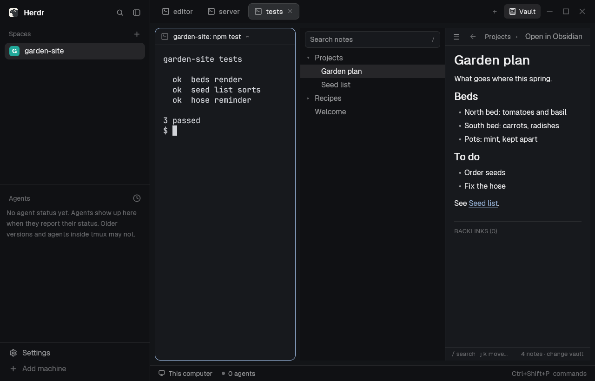

# tabs-plus

Herdr's tab bar with side-panel buttons for Wingman, Vaultr and Wayfindr, and a side panel that is remembered for each space.



## Features

- **Panel buttons for mods.** A button for each Wingman view (Review, Edit, Changes) and for Vaultr that the layout's side panel holds. Click one to show that panel, and again to hide it.
- **A panel per space.** Each space remembers whether its side panel was open and which tab it showed. Switching spaces puts that back.
- **A width per panel tab.** Each panel tab keeps the width you dragged it to. Wingman starts at 960px and Vaultr at 520px.
- **A Wayfindr button.** When the layout has a `wayfindr` block, a button shows and hides it. While it is shown it covers the terminals and the side panel, and going to another space closes it.
- **Palette commands.** `tabs-plus.wingmanReview`, `tabs-plus.wingmanEdit`, `tabs-plus.wingmanChanges` and `tabs-plus.vaultr` show that panel tab. "Tabs: Show or hide the side panel" toggles the panel.
- **Herdr's tab bar.** Everything the shipped `tabs` mod does: select, drag to reorder, double-click to rename, right-click for the menu, scroll to change tab, and the window buttons.

## Needs

- Herdr, and a layout of your own, since Herdr's shipped layouts are read-only.
- It replaces the `tabs` mod in that layout. Herdr's Files and Changes panels get no button.
- Wingman, Vaultr and Wayfindr are optional. A button shows only for a block the layout has.
- It is a clone of Herdr's `tabs` 0.1.14 (Apache-2.0, see `LICENSE`), so later changes to the shipped `tabs` don't reach it.
- It reads the layout and keeps panel choices and widths in its own storage. It runs no programs and uses no network.

## Install

Tell your agent:

```text
Read ~/.config/herdr-app/AGENTS.md, then add this mod: https://github.com/jbped/herdr-mods/tree/main/tabs-plus
```

Or by hand:

1. Copy `mods/tabs-plus/` to `~/.config/herdr-app/mods/`.
2. In a layout of your own, set the `tabs` block's `content.mod` to `tabs-plus`.
3. Add the blocks of the mods you use to the `panel-body` stack, and raise the `panel` column's `max` (for example to 2400) so wide tabs fit.
4. Run `herdr-app check ~/.config/herdr-app/mods/tabs-plus`.

## Use

Click a panel button to show its panel and click it again to hide the panel. Drag the panel's edge to set that tab's width. It has no keys of its own.

| Palette entry | Action |
|---|---|
| Tabs: Show or hide the side panel | toggle the panel on the tab it last showed |
| Wingman: Review / Edit / Changes | show that Wingman panel tab |
| Vaultr: Open in the side panel | show the Vaultr panel tab |

How each addition works and the layout blocks it looks for: [`mods/tabs-plus/README.md`](mods/tabs-plus/README.md).
