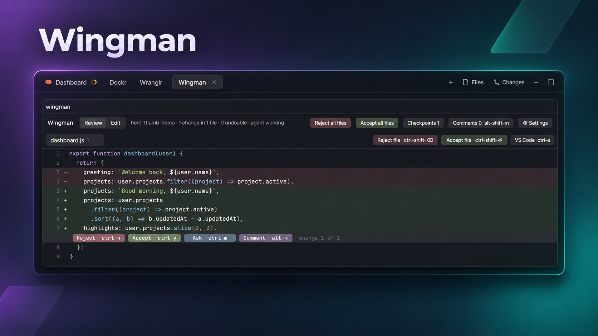

# Wingman

A review pane for what coding agents change: whole-file diffs with Accept and Reject per change, per file or for everything.



## Features

- Captures any agent's changes by snapshotting the repo, and every Claude Code edit through its hooks.
- Accept, reject and undo a change, the selected lines, a file or everything. Changes stay live on disk while you review.
- A rejection tells the agent which lines were put back. A comment reaches the agent as your message.
- The diff is an editor, with a file tree, autosave and a merge when the agent writes the file you are editing.
- Syntax highlighting for JavaScript, TypeScript, JSX, Vue, Angular, HTML, CSS, C#, JSON, Markdown and YAML.
- Your git index, stash and branch are never touched.

## Needs

- git, and `python3` for the installer.
- Windows, macOS or Linux. On Windows the installer also sets up Claude Code in WSL.
- The installer adds hooks to `~/.claude/settings.json` (backed up first). On Windows it sets `HERDR_WINGMAN_DIR` and adds two `WSLENV` entries.
- It runs git and its own snapshot scripts, and writes review data to `<git-dir>/wingman/` and `~/.config/herdr-app/data/wingman/`. No network.

## Install

Tell your agent:

```text
Read ~/.config/herdr-app/AGENTS.md, then add this mod: https://github.com/jbped/herdr-mods/tree/main/wingman
```

Or by hand:

1. Copy `mods/wingman/` to `~/.config/herdr-app/mods/`.
2. Run the installer from that folder:
   - Windows: `powershell -ExecutionPolicy Bypass -File install\install.ps1 install`, then restart Herdr.
   - macOS and Linux: `sh install/install.sh install`.
3. Run `herdr-app check ~/.config/herdr-app/mods/wingman`.
4. Open it beside an agent: `pane.split` with `{"direction": "right", "mod": "wingman"}`.

Keys, views, settings and uninstall: [`mods/wingman/README.md`](mods/wingman/README.md).
