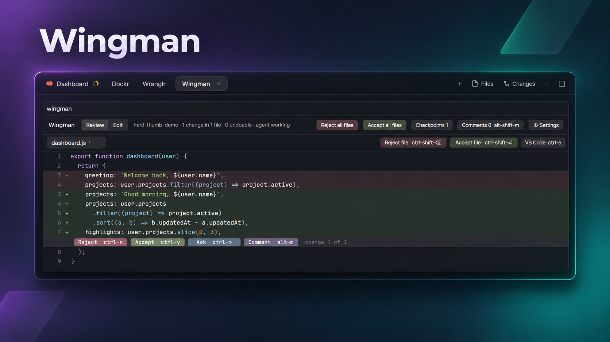

# Wingman

A review pane that sits beside a coding agent and shows what the agents in the shown space changed. Each changed file is a tab, drawn as the whole file with removed lines in red and added lines in green, and every change has Reject, Accept and Comment buttons under it. The changes are already on disk while you review: Accept keeps a change, Reject writes the original lines back, and `ctrl-z` undoes either. The diff is also a text editor, and an Edit view adds a file tree of the space's repos.

## What you see

One pane on `background`, 13px text in `foreground`, top to bottom:

- **Header**, 40px, `border` line below:
  - "Wingman" in semibold.
  - A Review · Edit switch on `raised`. Each side is 22px high with 12px text, and the shown one sits on `selected`.
  - A summary in 11px `muted`, such as `shop-api, shop-web · 5 changes in 3 files · 2 undoable`. It adds ` · saving…` while writes are queued and ` · agent working` while an agent in the space is in a turn.
  - Buttons on the right, each 22px high with 11px text: "Comment last rejection  ctrl-r" on `raised` once something was rejected, "⚙ Settings" on `raised`, and, while there are changes, "Reject all files" on `ansi1` at alpha `55` and "Accept all files" on `ansi2` at alpha `55`.
- **File tree**, Edit view only, a 240px column on the left with a `border` line on its right:
  - With more than one repo, each repo's folder name heads its files in 11px semibold `muted`.
  - Rows are 22px, indented 12px per level. Folders come first, then files, sorted by name. A folder shows `▸` or `▾` and its name in `muted`. A file shows its name in `foreground`, and the open file's row sits on `selected`.
  - A file or folder with changes shows its change count in `ansi3`. One with unsaved edits shows `●` in `accent`.
  - It lists tracked and untracked files, without ignored ones. Deleted files under review are added to the list.
- **Tab strip**, 36px, `border` line below:
  - One tab per file, 26px high with 6px corners, the shown one on `selected`. A tab shows the repo name in 10px `dim` when the space has more than one repo, the file name in 12px, `●` in `accent` for unsaved edits, and a tag in 10px `muted`: the change count, `new`, `deleted`, or `error` in `ansi1`.
  - In the Edit view, a file opened from the tree that has no changes has a `×`.
  - When the tabs do not fit, a 2px `dim` bar at the bottom of the strip shows the position.
  - Pinned on the right: `2/5 · ctrl-shift-↑/↓` in 10px `dim` when there is more than one tab, "Save  ctrl-s" on `accent` at alpha `55` when the file has unsaved edits, and "Reject file  ctrl-shift-⌫" on `ansi1` at alpha `40` and "Accept file  ctrl-shift-⏎" on `ansi2` at alpha `40` when the file has changes.
- **Conflict banner**, only when it applies, on `ansi3` at alpha `22`: "The agent changed the same lines you're editing." with Keep mine and Take agent's, or "The file was deleted while you were editing it." with Keep mine and Drop my edits.
- **Message line**, only when it applies, 12px in `muted`, or `ansi1` for an error: "Waiting for an agent in a git repo in this space…", "Loading…", "No changes to review", "No file open: pick one in the file tree (ctrl-b)", or the error.
- **The file**, filling the rest, in the font from Herdr's settings (JetBrains Mono when none is set) at 12px:
  - Every line of the file is a 20px row: a 44px line number in `dim`, right aligned, a 14px sign column, then the text with syntax colors.
  - An added line has `+` in `ansi2` on `ansi2` at alpha `22`. A removed line has `-` in `ansi1` on `ansi1` at alpha `22`, shown above the lines that replaced it.
  - Under each change, a 20px button row on `raised`, or `selected` for the current change. Starting 64px from the left it holds three 110px by 16px buttons, 6px apart: "Reject  ctrl-n" on `ansi1`, "Accept  ctrl-y" on `ansi2`, "Comment  ctrl-p" on `ansi4`. Then `change 2 of 5` in 11px `dim`.
  - The cursor is a 2px bar in `accent`, or `dim` when the pane does not have the keyboard. Selected text and selected lines sit on `selection`, and selected lines also get a 2px `accent` bar on the left.
  - A scrollbar on the right.
  - While lines are selected, a bar floats 12px above the bottom on `popover` with an `accent` border: `3 lines selected`, "Reject  ctrl-n" and "Accept  ctrl-y" when the selection holds changed lines, "Comment  ctrl-p" and "Clear  Esc".
- **Dialogs**, as Herdr overlays on `popover`:
  - Comment and Comment last rejection: 560px wide, 290px high, or 430px with quoted lines. A 15px semibold title with `Esc` on the right, the file and line range in `muted`, a 130px box on `background` with the quoted lines (`+` lines in `ansi2`, `-` lines in `ansi1`), a text area with an `accent` border, a hint naming the agent's terminal, and a "Send  Ctrl+⏎" button on `solid`.
  - Settings: 460px by 360px. Three switches, 34px by 18px, on `accent` when on: Auto note on rejections, Note on my edits, Autosave. Then "Also save after typing stops for" with six choices: Focus change, 1s, 2s, 3s, 5s, 10s.
  - Right-click menu: 260px wide at the pointer, 28px items with the key in `dim` on the right.

## How it behaves

Agent status:

- **Working or blocked**: both count as the agent being in a turn. When the first agent in the space enters a turn, Wingman takes a snapshot of the repo that agent started in. Every 3 seconds, each file that differs from the snapshot joins the review, with its snapshot content as the original. The header says "agent working".
- **Done or idle**: one more pass picks up the last changes, then the snapshot is dropped. Comments waiting for that agent are typed into its terminal.
- A file already under review keeps its first original, so the review always shows the net change since review began.
- Claude Code edits arrive through its hooks as well, read every half second, in any git repo, including repos other than the one the agent started in. Those repos join the space's review.
- Files outside a git repo and binary files are not reviewed.

Which review a pane shows:

- A pane shows the review of the space the window shows. Each space keeps its own tabs, selection and undo history while the pane lives.

Reviewing:

- Accept keeps a change and removes it from the review. Nothing in the file changes.
- Reject writes the original lines back to the file. Rejecting a whole file that the agent created deletes it.
- A change's own buttons act on the whole change. `ctrl-y` and `ctrl-n` act on the selected lines when there are any, else on the current change. Unselected changed lines stay pending.
- `ctrl-shift-enter` and `ctrl-shift-backspace` accept and reject the shown file. The header buttons do the same for every file.
- `ctrl-down` and `ctrl-up` go to the next and previous change, centred in the pane. `ctrl-shift-down` and `ctrl-shift-up` go to the next and previous file. Both wrap around.
- `ctrl-z` undoes the last accept, reject or edit. Undoing a reject also withdraws its note if the agent has not read it yet.
- When a file's last change is decided, its tab goes and the next file is shown.
- A rejection queues a note for the agent that made the change, such as "Code review: the user rejected your change at lines 12-14 in /home/dev/shop-api/src/cart.js. The original lines are back on disk." The agent gets it with its next tool call or prompt. Only Claude Code receives these notes.

Comments:

- Comment (`ctrl-p`, a change's Comment button, or the menu) opens a dialog about the selected lines, else about the current change. Enter adds a line. `ctrl-enter` or the Send button sends, and `escape` or an empty text closes without sending.
- The comment goes to the agent that made the change, else to the space's only agent. It is typed into that agent's terminal as your message once the agent is out of its turn. Up to 40 selected lines are quoted with it.
- Comment last rejection (`ctrl-r`) sends your reason for the last rejection as a note, delivered like a rejection note. Rejecting all files clears it.

Mouse:

- Click a tab to show that file. The wheel over the tab strip scrolls the tabs.
- Click in the text to place the cursor. Drag to select text, double-click for a word, triple-click for a line.
- Click a line number to select the line. Drag, Shift+click, `shift-down` or `shift-up` extend the selection. A click inside the selection, or `escape`, clears it.
- Right-click opens the menu and never changes the selection: Comment, then Reject, Reject with comment… and Accept on a change or on selected changed lines, Comment last rejection once there is one, and Clear selection.
- The wheel scrolls the file in whole rows. Shift+wheel or a sideways swipe scrolls long lines.

Editing:

- Typing, `backspace`, `delete` (with `ctrl`: by word), `enter` (keeps the indent), `tab` and `shift-tab` (indent and outdent with the file's own unit), `ctrl-a`, `ctrl-c`, `ctrl-x` and `ctrl-v` work on the current file's lines. Without a selection, copy and cut take the whole line. Removed lines are read-only.
- Arrows, `ctrl-left` and `ctrl-right` by word, `home` (first after the indent, then column 0), `end`, `pageup`, `pagedown`, `ctrl-home` and `ctrl-end` move the cursor. Shift with any of them selects.
- An edit on unchanged lines is kept as accepted and never shows up for review. An edit inside the agent's added lines stays part of that pending change.
- `ctrl-s` saves. `ctrl-shift-y` redoes an undone edit. Typing within one second of the last key joins the same undo step.
- With Autosave on, edits are saved when the pane or the window loses focus, when you switch files, spaces or views, when you close a tab, and after the chosen pause in typing.
- A save queues a note for the agent that changed the file, naming the edited lines and asking it to read the file again. A newer save replaces a note the agent has not read.
- When the agent writes a file that has unsaved edits, both edits are merged. Where both changed the same lines, the agent's lines win with Autosave on. With it off, the conflict banner asks, and Accept, Reject and Save wait for the answer. A merge clears that file's edit undo.

Views:

- `ctrl-shift-r` or the header switch changes between Review and Edit. `ctrl-b` shows or hides the tree, and opens the Edit view from Review.
- In the tree, clicking a folder opens or closes it and clicking a file opens it in a tab, with its diff when it has changes. The tree is read again every 5 seconds while shown.
- An opened tab's `×` closes it. With Autosave off, a tab with unsaved edits refuses to close and says to save first.

Settings apply at once and are kept across restarts. All three switches are on by default, and the pause is Focus change.

## Built from

- `mods/wingman/mod.json`: `{ "place": "none", "title": "Wingman", "focusable": true, "palette": [{ "title": "Open Wingman", "command": "pane.split", "args": { "direction": "right", "mod": "wingman" }, "about": "Review and edit agent changes beside the focused pane" }] }`. No layout and no `keys.json`: the pane handles its own keys while it has the keyboard.
- `main.js`: the `View`. `props().form` picks the role:
  - none: the pane. An optional `props().root` names the repo to open in place of the agents' folders.
  - `"prompt"` and `"reason"`: the comment dialogs, with `{terminal, file, where, quote?}`.
  - `"settings"`: the settings dialog.
  - `"menu"`: the right-click menu, with `{items}`. An item runs `wingman.<cmd>` and the pane does the work.
  - It also holds the timers: 250 ms autosave focus check, 500 ms capture lease and agent status, 1 s space follow, 2 s disk check, 3 s capture pass, 5 s tree refresh.
- `model.js`: the diff model with no Herdr imports. A file is baseline lines and current lines plus hunks `{o, oc, n, nc}`. `parseHunks` reads `git diff -U0`. `acceptAt`, `rejectAt`, `acceptAll`, `rejectAll` and `partialAt` each return `{state, write}`. `rows` builds the display rows, with a button row after each hunk.
- `store.js`: the review store of one repo, `<git-dir>/wingman/` with `index.json` (`{version: 1, files: {<path>: {baseline, created, by?, as?}}}`) and `baselines/`. Every write passes the content it expects to replace, and fails when the file changed.
- `capture.js`: the snapshot, the changed paths between two trees, and adding them to the store. `hostPath` turns a WSL folder (`/mnt/c/...`, `\\wsl.localhost\<distro>\mnt\c\...`) into `C:/...` when Herdr runs on Windows.
- `journal.js`: reads the hook's event files in name order, sets each file's baseline from Claude Code's `tool_response.originalFile`, and records each space's repos. Also the feedback queue, the comment outbox and the settings file.
- `merge.js`: three-way merge and the diff of merged texts, through git on temporary files. `changedRanges` and `mapLine` for edit notes and the cursor.
- `edit.js`: text edits on a reviewed file, cursor movement, indent unit, tab stops of 4. No Herdr imports.
- `tree.js`: `buildTree`, `flatten` and `parents` for the file tree. No Herdr imports.
- `highlight.js`: language by extension or file name, Prism tokens as per-line spans, and `color(type, theme)`, which maps token types to `ansi1` to `ansi6`, `dim`, `muted` and `foreground`.
- `prism.js` and `grammars.js`: Prism 1.30.0, copied unchanged, with the grammars markup, csharp, json, markdown, css, typescript, jsx, tsx, docker, yaml, properties and scss. `LICENSE-prism` is its MIT license.
- `snapshot.sh` and `snapshot.ps1`: copy `<git-dir>/index` to `<git-dir>/wingman/snap.index`, run `git --no-optional-locks add -A` and `git write-tree` with `GIT_INDEX_FILE` set to the copy, and print the tree id.
- `hooks/wingman-hook.sh`: the Claude Code hook, POSIX `sh`. With `post` it saves the hook input as `events/<nanoseconds>-<terminal>-<pid>.json`. With `post` and `prompt` it prints `feedback/<terminal>.ctx` as `additionalContext` and removes it. It does nothing without `HC_TERMINAL_ID` or the data folder.
- `install/install.sh [install|uninstall]`: adds or removes two entries in Claude Code's `settings.json`, a `PostToolUse` hook with matcher `Edit|Write|MultiEdit|NotebookEdit` and a `UserPromptSubmit` hook. Each command ends in `# herdr-wingman-hook` and has a 10 second timeout.
- `install/install.ps1 [install|uninstall]`: sets the user variable `HERDR_WINGMAN_DIR`, adds `HC_TERMINAL_ID` and `HERDR_WINGMAN_DIR/p` to the user variable `WSLENV`, and runs `install.sh` in WSL.
- `README.md`: the reference for keys, settings and files.
- Herdr functions: `theme`, `settings`, `props`, `spaces`, `agents`, `panes`, `terminals`, `appHome`, `readTextFile`, `writeTextFile`, `exec`, `hc`, `openOverlay`, `closeOverlay`, `nextCommand`, `run`. From `fs/promises`: `exists`, `readdir`, `mkdir`, `unlink`. From `gpui-base`: `v_virtual_list`, `VirtualListScrollHandle`, `Scrollbar`, `TextareaState`, `Textarea`. Also `cx.write_to_clipboard`, `cx.read_from_clipboard`, `cx.sleep` and `window.is_window_active`.
- Commands: `pane.split` from the palette entry. Its own, sent with `run`: `wingman.prompt`, `wingman.reject`, `wingman.rejectReason`, `wingman.accept`, `wingman.reason`, `wingman.clear` and `wingman.settings`. The pane also answers `wingman.save` and Herdr's `focus`.
- Programs:
  - `git`: `rev-parse --show-toplevel --absolute-git-dir`, `ls-files --cached --others --exclude-standard -z`, `diff --no-index -U0 --diff-algorithm=minimal`, `diff-tree -r --no-renames --name-status -z`, `cat-file blob`, `merge-file -p`, and `add -A` and `write-tree` in the snapshot scripts.
  - `sh` or `powershell` to run the snapshot script, with `cp`, `rm` and `mkdir` inside it.
  - `mkdir -p` and `rm -f`, or `cmd /c mkdir` and `cmd /c del /f /q` on Windows, for folders and deleted files inside a repo.
  - `hc send <terminal> <text>` to type a comment into an agent's terminal.
  - The hook runs `cat`, `date`, `tr`, `printf`, `mv`, `mkdir` and `rm`.
  - The installer runs `python3`, `cp` and `mkdir`, and on Windows `wsl.exe` with `wslpath`.
  - No network.
- Files outside its own folder:
  - In each reviewed repo it reads any file you open and writes the files you reject, edit or save.
  - `<git-dir>/wingman/`: `index.json`, `baselines/`, `capture.json`, `snap.index`. It reads `<git-dir>/index`.
  - `~/.config/herdr-app/data/wingman/`: `events/`, `feedback/`, `outbox/`, `tmp/`, `spaces.json`, `settings.json`.
  - `~/.config/herdr-app/data/wingman-leader.json` and `~/.config/herdr-app/data/wingman-capture.log`.
  - The installer writes `settings.json` and `settings.json.bak-herdr-wingman` in `$CLAUDE_CONFIG_DIR`, or `~/.claude` when that is unset.
- Its look is Herdr's: theme tokens only, and no art.

## Watch out

- A pane copy cannot tell which pane it is. So every copy shows the active space's review, and one copy holds a lease in `wingman-leader.json` (5000 ms, renewed every 500 ms) and does all capture, event reading and comment delivery for every space that has a Wingman pane.
- A space without a Wingman pane gets no snapshot. Open the pane before the agent starts its turn.
- The lease and the log live under `data/`, not under `mods/wingman/`. Any write under a mod folder reloads every copy.
- The folder name `wingman` is used in the snapshot script path (`<appHome>/mods/wingman`), in `openOverlay`, in the `panes()` filter and in the command names. Renaming the mod means changing all four.
- Every `exec` runs on this computer, with no `on`. A space on another machine is not reviewed.
- Rejection notes, edit notes and rejection reasons reach only Claude Code, through the hook. Comments go through `hc send` and reach any agent.
- Captured changes are credited to an agent only when exactly one agent is in a turn and it is Claude Code. Other captured files have no author, so they get no notes, and a comment needs the space to have exactly one agent.
- A virtual list's rows cannot take mouse handlers and the list reports no scroll position. A transparent layer over the list takes every press, drag, right-click and wheel turn and maps `y / 20` to a row. That is why the pane scrolls in whole rows and why the change buttons are hit by x position.
- `scroll_to_item` moves the list only when the row is off screen. Scrolling up asks for the new top row and scrolling down for the new bottom row.
- The list calls its row function twice a frame, first with the range `[0, 1)`. Only the second call says which row is on top.
- A handler's `cx` is dead once the handler returns. Each queued disk write runs in its own `cx.spawn`.
- Folder watch events did not fire on Windows in testing, so files and `index.json` are compared with memory every 2 seconds.
- Herdr has no blur event for mods. Focus is checked every 250 ms.
- `fs/promises` writes only under `~/.config/herdr-app`. Folders inside a repo are made, and files deleted, through `exec`.
- With `core.autocrlf`, a snapshot blob has LF where the file on disk has CRLF. The baseline takes the line endings the file has now.
- Claude Code reports no `originalFile` for a Write to a very large file. That file is left to the snapshot capture.
- The hook names events by `date +%s%N`. On macOS that falls back to whole seconds, so two edits in one second are ordered by terminal and process id.
- On Windows, only WSL folders under `/mnt/<drive>` are mapped to a Windows path.
- Review keys match `ctrl-` keystrokes only. `ctrl-shift-z` is Herdr's `pane.zoom`, so redo is `ctrl-shift-y`.
- The cursor column counts one cell per character. Wide characters and emoji put the cursor in the wrong column.
- Tokenize in chunks of 150 to 300 lines with `cx.sleep(0)` between them, or Herdr interrupts the script on a long file. While typing, only the edited lines are tokenized, and the whole file again 500 ms after the last key.
- Limits: 40 quoted lines per comment, 6 line ranges per edit note, 40 cached highlight results, an event file dropped after 3 failed reads, a comment dropped when its terminal is gone, and the log cut to its last 10,000 characters once it passes 20,000.
- Nothing in the mod sends `wingman.save`. It is there for a key or another mod.
- `mod.json` has `"place": "none"`, so the pane appears only when `pane.split` opens it.

## Done when

- `herdr-app check ~/.config/herdr-app/mods/wingman` passes.
- `sh install/install.sh install` adds one `PostToolUse` and one `UserPromptSubmit` entry ending in `# herdr-wingman-hook` to Claude Code's `settings.json` and writes `settings.json.bak-herdr-wingman`. A second run leaves one of each. `uninstall` removes both and leaves other hooks in place.
- The palette shows "Open Wingman", and it opens the pane to the right of the focused pane.
- With no agent in a git repo, the pane says "Waiting for an agent in a git repo in this space…".
- An agent in a git repo starts a turn and changes a file. Within a few seconds a tab with the file's change count appears, `<git-dir>/wingman/index.json` lists the file, and `git status` shows the same index and branch as before.
- Reject on a change puts the original lines back in the file on disk. `ctrl-z` brings the agent's lines back.
- Accept on the last change of a file removes its tab and leaves the file on disk as the agent wrote it.
- Rejecting a Claude Code change writes a line to `~/.config/herdr-app/data/wingman/feedback/<terminal>.ctx`. The file is gone after Claude's next tool call or prompt.
- A comment sent while the agent is in a turn appears in the agent's terminal only after the turn ends.
- `ctrl-b` shows the file tree. Clicking an unchanged file opens it in a tab with a `×`. Typing in it shows `●` on the tab, and moving focus to another pane saves it.
- Turning off Autosave in Settings stops that save, and `~/.config/herdr-app/data/wingman/settings.json` holds `"autosave": false`.
