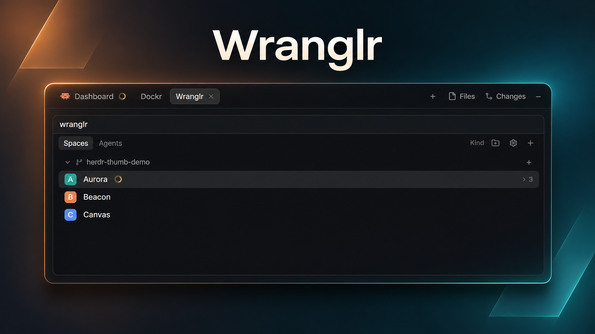

# Wranglr

A spaces sidebar that sorts spaces into Groups: one per Repo, one per Workspace, and Custom groups you fill by hand.



## Features

- **Repo groups.** Every clone and worktree of a Repo, on any Machine, in one group.
- **Workspace groups.** Named lists of Repos from the config file, shown even with no spaces open.
- **Custom groups and Subgroups.** Groups you make and fill by hand. Any group can have Subgroups, such as Working and Review.
- **Drag and drop.** Drag a space onto a row, a group or out of every group. Drag groups to reorder them.
- **Start a space from a group.** "+" opens the Repo's main checkout or the Workspace home. Its right-click menu makes a new git worktree or picks the Machine.
- **Worktree rules.** Where new worktrees go and which ref new branches start from, for all Repos or one.
- **Automatic names.** New spaces are named `<ticket id> <words>` from their branch.
- **Agent marks.** Each row shows agents that need you, are working or are done. Click the marks to go to the most urgent one.
- **Machines.** A space on another Machine shows its name. An unreachable one is dimmed, with Connect below the list.
- **Sorts and folding.** Recent, Kind, A-Z or Manual. Click a group's header to fold it.
- **Editor file.** A `<name>.code-workspace` file in each Workspace home lists its Repos.
- **Palette.** Every command is in the `palette` mod.

## Needs

- git. `claude` is used only to name a space whose branch has too many words.
- It replaces the `spaces` block in your layout and rebinds `alt-1` to `alt-9`, `ctrl-shift-pagedown` and `ctrl-shift-pageup`.
- It runs git, reads and writes `~/.config/herdr-app/wranglr.json`, keeps its state in `~/.config/herdr-app/data/wranglr/`, and writes a `<name>.code-workspace` file in each Workspace home. No network of its own.

## Install

Tell your agent:

```text
Read ~/.config/herdr-app/AGENTS.md, then add this mod: https://github.com/jbped/herdr-mods/tree/main/wranglr
```

Or by hand:

1. Copy `mods/wranglr/` to `~/.config/herdr-app/mods/`.
2. In your own layout (clone a shipped one with `layout.clone`), set the spaces block to `"content": { "mod": "wranglr" }`.
3. Merge `keys.json` into `~/.config/herdr-app/keys.json`.
4. Run `herdr-app check ~/.config/herdr-app/mods/wranglr`.

## Use

Click a row to go to the space. Right-click a row, a group or "+" for its menu. In the header, the sort button cycles the sorts, the folder adds a Custom group and the gear opens settings.

| Key | Action |
|---|---|
| `alt-1` to `alt-9` | go to the space at that position in the list |
| `ctrl-shift-pagedown` / `ctrl-shift-pageup` | next / previous space in the list's order |
| `ctrl-shift-m` | move the focused space to a Group or Subgroup |

It works with no config file. Workspaces, the config file, every command and limits: [`mods/wranglr/README.md`](mods/wranglr/README.md).
