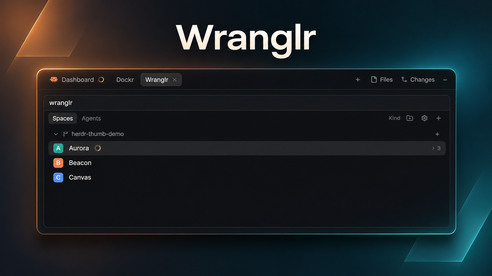

# Wranglr

A spaces sidebar that sorts your spaces into Groups. Every clone and worktree of one git repository, on any Machine, sits in one Repo group. Each Workspace from a config file (a named list of Repos) has a group that shows even with no spaces open. Custom groups are made and filled by hand, and any group can have Subgroups. Each row shows the space's avatar, name, Machine, branch, ahead and behind counts, and marks for what its agents are doing. You drag rows and groups, fold groups, start a space or a git worktree from a group's "+", and new spaces are named from their branch.



## What you see

The mod fills the layout's spaces block, on `chrome`, at 13px. Top to bottom:

- **Header**, 31px, 11.5px in `dim`: "Spaces", then four 26px buttons that turn `hover` and `foreground` under the pointer:
  - the sort, as 11px text: Recent, Kind, A-Z or Manual.
  - a 14px `folder-plus` icon, "New group".
  - a 14px `settings` icon, "Wranglr settings".
  - a 14px `plus` icon, "New space".
- **Warning line**, only when the config file has problems: 24px, `raised`, 11px in `blocked`, reading "wranglr.json: 2 problems". Its tooltip lists each problem.
- **The list**, the only part that scrolls, with the scrollbar always shown:
  - **Group header**, 26px with 4px above, 11.5px in `muted`: an 11px chevron (`chevron-down`, or `chevron-right` when folded), a 12px kind icon in `dim` (`layers` for a Workspace, `git-branch` for a Repo, `folder` for a Custom group), the name in semibold, the row count in `dim` when folded, and a 20px "+" button.
  - **Space row**, 30px, corners 8px. The shown space's row is on `selected`. Others turn `hover` under the pointer. Left to right:
    - an 18px avatar with 5px corners: the first letter of the name in white bold 10.5px on the space's color.
    - the name in `foreground`, cut at 150px.
    - the Machine's name as a chip (10.5px, `dim` on `raised`) when the space is on another Machine.
    - right-aligned at 11.5px in `dim`: the repo name and branch joined by " · ", then `↑2` in `ansi2` and `↓1` in `ansi1`. The repo is left out when it equals the space's name. The branch is left out when it equals the name or is `main` or `master`.
    - the agent marks (see How it behaves).
  - **Subgroup header**, 24px, indented 24px: a 10px chevron, the name, the row count when folded, and a "+" button. Its rows are indented 16px.
  - A 1px `border` line, then the Loose spaces (spaces in no Group).
  - An empty drop area at least 36px high.
- **Machine lines**, under the list: one 26px line at 11px in `dim` for each Machine that is not connected. It shows a 13px `server` icon, the name, the state (such as "asleep" or "unreachable") and a 6px dot.
  - A rebuilt Machine shows "rebuilt ·" and Connect.
  - A Machine that needs a login shows "needs a login: run" in `blocked`, the command `hc machine login devbox`, and a Copy button that then reads "Copied".

**The rail.** When the layout node `sidebar` is narrower than 160px, the header keeps only "+", and each space is a 32 by 26px cell: its position number, and a status glyph at the right in that status's theme color (`●` for blocked or done, `·` otherwise). The tooltip is the space's name. Machine lines become one `server` icon each.

**Dialogs and menus**, all on `popover`:

- **Menu**, a 220px popup of 31px items: a 14px icon, the label, and a key chip when the item has a key.
- **Text input**, a 420px dialog: a title, "Name" or "Branch", a 36px field with an `accent` border, Cancel and Save.
- **Move**, a 420px dialog: "Move orchard-api", a 36px filter field, and 30px choices up to 300px high. "No group" is first, then each Group with its Subgroups indented under it. The space's present place reads "current".
- **Wranglr settings**, a 460px dialog: Sort, Default Machine, "+ on a Repo group", "Name new spaces from their branch" and "Agent status on each space" as 28px choice chips, then Worktree location, Ticket pattern and "New spaces run" as 32px text fields.
- **Group settings**, a 460px dialog: Machine chips numbered in order of preference. A Repo adds "Worktree location" and "New branches start from". A Workspace adds one "Workspace home on …" field per Machine.

## How it behaves

**Where a space goes**, first match wins:

1. Where you put it by hand (drag or Move).
2. The Workspace whose "+" started it.
3. The Workspace whose Workspace home is the space's folder.
4. The Repo its first terminal's folder is in.
5. Otherwise it is a Loose space.

**Groups**

- A Repo group appears when a space is first seen in that Repo. Empty, it stays until dismissed, and comes back when a space is seen there again. Two Repos with the same name show their last two path parts, such as `lumen-labs/orchard-api`.
- A Workspace group shows for every Workspace in the config file.
- A Group's Machines are its own list, then the default Machine, then this computer, then any other. Only Machines that are ready and hold the Repo's main checkout or the Workspace home count. A Repo or Workspace group with none has no "+".

**Agent status**, at the end of a row, one mark per state that has agents, with a count in 11px `dim` when above one:

- blocked: a 14px square with 4px corners, `blocked` at 15% opacity, holding a bold "!" in `blocked`.
- working: a 12px ring in `working` that turns once every 900 ms.
- done: a 7px dot in `done`.
- idle: nothing.

Hovering the marks lists each agent as "label: needs you", "working", "done" or "idle". Clicking them focuses the pane of the most urgent agent: blocked, then done, then working. The setting `agents: false` removes the marks.

**Clicks and drags**

- Click a row: go to that space. Right-click: Herdr's own space menu.
- Drag a row onto a row: it lands above it, or below when released on the lower half. A 2px `accent` line shows where. The dragged row fades to 50%.
- Drag a row onto a Group or Subgroup header: it goes to the end. The header gets a 1px `accent` border.
- Drag a row onto the empty area under the list: it becomes a Loose space.
- Drag a Group header onto another: the groups reorder. Drag orders are always saved, and show under the Manual sort.
- Click a Group or Subgroup header: fold or unfold it.
- Right-click a Group header: Add subgroup…, Rename… and Remove group (Custom groups), Dismiss (an empty Repo group), Settings… (key `S`). Right-click a Subgroup header: Rename…, Remove subgroup.
- Click a group's "+": a new space in the Repo's main checkout, the Workspace home, or the home folder for a Custom group, on the Group's first Machine. A Workspace's space is named after the Workspace. With the setting `plus: "worktree"`, a Repo's "+" asks for a branch first.
- Right-click "+": "Open on devbox" for each of the Group's Machines (keys `1` to `9`), and "New worktree…" (key `W`) on a Repo group.
- Header: the sort button moves to the next sort and saves it. The folder button asks for a name and adds a Custom group. The gear opens Wranglr settings. "+" starts a space as Herdr does. With a default Machine set, it starts there, or on this computer when that Machine is not ready.
- Menus take up, down, enter, escape and each item's key. The Move dialog takes up, down, enter and escape, and filters as you type. Every typed word must match.
- A rebuilt Machine's Connect removes the Machine and adds it again with the same target and name. It reads "Connecting…" meanwhile, and shows the error in `blocked` when it fails.

**Sorts**

- Kind: Workspaces, then Repos, then Custom groups, each by name. Rows by name.
- A-Z: groups by name, rows by name.
- Recent: groups and rows by their spaces' latest tab activity, empty groups last.
- Manual: your drag order. Groups never dragged follow Kind, and rows never dragged follow Herdr's order.

**New worktree.** The branch you type fills the location pattern, by default `{clone}/.worktrees/{branch}`. `{clone}` is the Repo's main checkout on that Machine, `{branch}` the branch and `{repo}` the Repo's name. A branch that exists is checked out. One that is only on the remote is fetched and tracked. A new one starts from the Repo's `from` ref, else the remote's default branch, else `main`, else `master`, else the main checkout's HEAD, with no upstream. A ref on a remote is fetched first. When that fetch fails, a warning notification says the branch starts from the local copy. When git fails, an error notification shows git's message and no space is started.

**Automatic names.** A space on the branch `feature/4821-fix-login-redirect` is renamed "4821 Fix login redirect".

- The ticket id is the first group of the `ticket` pattern matched against the branch.
- The words are the branch without its first path part and without the id, split at `-`, `_`, `/`, `.` and spaces, in lower case with the first capitalised.
- One to four words name the space at once. With more than four, Wranglr waits until an agent in the space has a title, then asks `claude` for one to four words.
- A space you named yourself is left alone. So are spaces on `main`, `master`, `develop`, `staging` and `HEAD`.

**Machines.** A space on a Machine that is not ready stays in its place at 50% opacity, with no clicks, no git detail and no marks. The keys skip it.

**Keys and commands.** `alt-1` to `alt-9` (`wranglr.select1` to `wranglr.select9`) go to the space at that position in the list. `ctrl-shift-pagedown` and `ctrl-shift-pageup` (`wranglr.next`, `wranglr.prev`) step through the list's order and wrap. `ctrl-shift-m` (`wranglr.move`) opens Move for the focused space. Unbound: `wranglr.new` ("+" of the focused space's Group), `wranglr.name` (name the focused space again), `wranglr.fold`, `wranglr.sort`, `wranglr.group` (that Group's settings) and `wranglr.settings`.

**The config file**, `~/.config/herdr-app/wranglr.json`, is optional and read again every 5 seconds:

```json
{
  "settings": { "sort": "kind", "plus": "open", "worktrees": "{clone}/.worktrees/{branch}", "autoname": true,
                "ticket": "^(?:[a-z]+/)?#?(\\d{2,})", "agent": null, "machine": null, "agents": true },
  "workspaces": [{ "name": "Orchard", "repos": ["github.com/lumen-labs/orchard-api", "github.com/lumen-labs/orchard-web"],
                   "machines": ["devbox", ""],
                   "on": { "devbox": { "home": "/srv/orchard", "paths": { "github.com/lumen-labs/orchard-api": "/srv/orchard/api" } } } }],
  "repos": { "github.com/lumen-labs/orchard-api": { "machines": ["devbox"], "worktrees": "{clone}/../wt/{branch}",
                                                     "from": "origin/staging", "on": { "devbox": { "path": "/srv/orchard/api" } } } }
}
```

The values under `settings` above are the defaults. `agent` is the command new spaces from a group's "+" run, and `null` is a plain terminal. `""` names this computer. A Repo id is its remote URL without scheme, user and `.git`. An invalid setting falls back to its default, an invalid entry is dropped, and each is named in the warning line. The dialogs write to this file and keep every other key.

## Built from

- **Layout.** No layout of its own. In the person's layout the spaces block becomes `"content": { "mod": "wranglr" }`.
- **`mods/wranglr/mod.json`**: `"place": "none"`, `"title": "Wranglr"`, and a `palette` list of `{title, command, about}` for nine commands (`wranglr.move`, `next`, `prev`, `new`, `name`, `fold`, `sort`, `group`, `settings`), which a separate `palette` mod reads.
- **`keys.json`** (beside `mods/`, merged into the person's): the twelve `global` keys above.
- **`main.js`**: one `View` with six roles. With no `props().overlay` it is the owner: it holds the state, builds the World from Herdr's live data, calls the model, runs the effects and draws the list. Opened as an overlay, `props.dialog` picks the role: `menu` (`items`), `input` (`title`, `value`, `action`), `move` (`space`, `at`), `settings` (`settings`, `known`) or `group` (`group`, `values`, `known`, `worktrees`). An overlay never changes state. It hands its action to the owner through `shared`.
- **`model.js`**: every rule, as pure functions with no Herdr imports. `arrange(world, config, state)` returns the Tree `{groups, loose, order}`. `act(action, world, config, state)` returns `{state, effects}` for 22 actions, and the effects are `select`, `rename`, `start`, `ask`, `setting`, `settings`, `group` and `toast`. Also `emptyState`, `clonedMap`, `workspaceHome`, `ticketOf` and `branchWords`.
- **`config.js`**: parses `wranglr.json` (`parseConfig`, `DEFAULT_SETTINGS`, `settingError`, `groupError`) and edits it (`saveSetting`, `saveSettings`, `saveGroup`) with a compare-and-swap write tried up to four times.
- **`repos.js`**: `identityOf` turns a remote URL into a Repo id, so `git@github.com:lumen-labs/orchard-api.git` and `https://github.com/lumen-labs/orchard-api` are both `github.com/lumen-labs/orchard-api`. `origin` wins, else the first remote, else the basename of the main checkout. `resolveRepo` asks git. `makeResolver` caches answers, runs at most four at once and asks again after 60 s when a folder was in no repo.
- **`worktree.js`**: `addWorktree`, the git steps of New worktree.
- **`namer.js`**: `askName`, the `claude` call, and `cleanWords` for its answer.
- **`store.js`**: `loadState` and `makeSaver`, one writer for the state file, flushed in `close()`.
- **`workspacefile.js`**: writes each Workspace's `<name>.code-workspace` with one folder per Repo known on that Machine, relative when under the Workspace home.
- **`effects.js`**: `runEffects`, which turns each effect into a Herdr call. A failing effect posts a notification and the rest still run.
- **`README.md`**: the reference for keys and config.
- **Herdr functions**: `spaces`, `machines`, `panes`, `agents`, `focused`, `layout`, `theme`, `window`, `home`, `appHome`, `props`, `shared`, `setShared`, `nextCommand`, `run`, `notify`, `openOverlay`, `closeOverlay`, `exec` (with `on`, `cwd`, `timeout`), `hc`, `readTextFile` (with `on`), `writeTextFile`, `watchFolder`. Also `fs/promises` `mkdir`, `localStorage`, `cx.timer.every`, `cx.timer.after`, `cx.spawn` and `cx.write_to_clipboard`.
- **Commands it runs**: `space.select {id}`, `space.rename {id, name}`, `space.new {folder?, machine, argv?, name?}`, `pane.focus {pane}`, `app.settings {section: "machines"}`.
- **Shipped mods it uses**: `menu`, opened as a 200 by 260 popup with `{tab: "space", target: {id}}` for a row's right-click. `workspace-chrome` for its SVGs: `plus`, `folder-plus`, `settings`, `chevron-down`, `chevron-right`, `layers`, `git-branch`, `folder`, `server`, `spinner`, `search`, `minus`, `x`, `square-pen`. It has no art of its own.
- **Shared state**: `wranglr.action` (`{n, action}`, a counter so the owner runs each action once), `wranglr.view` (groups, focus, sort and plus for the overlays) and `space.colors` (each space's avatar color, the same key other space lists use).
- **Programs**:
  - `git`, on the space's Machine: `rev-parse`, `config --get-regexp`, `symbolic-ref`, `rev-list --left-right --count HEAD...@{upstream}`, `show-ref`, `remote`, `fetch` (60 s, reaches the network) and `worktree add`.
  - `claude -p <prompt> --model haiku` (60 s, reaches the network), only for a branch of more than four words or `wranglr.name`. The prompt holds the branch and the agent's title.
  - `wsl.exe` on Windows: `wsl.exe --cd <dir> -e git …` for a folder that starts with `/`, and `wsl.exe -e bash -lc` to reach `claude` when Windows has none.
  - `sh`, `printf` and `mv` on another Machine, to write the `.code-workspace` file there.
  - `hc machine ls --json` every 15 s, and `hc machine rm` and `hc machine add` for Connect.
- **Files outside its folder**:
  - `~/.config/herdr-app/wranglr.json`, read and written.
  - `~/.config/herdr-app/data/wranglr/state.json`, read and written: placements, Custom groups, Subgroups, folds, drag orders, dismissed and seen Repos, a snapshot of each space, and naming progress.
  - `<Workspace home>/<name>.code-workspace` on each ready Machine, read and written.
  - each local repo's git folder, watched for changes.
- **Look**: theme tokens only. The six avatar colors are fixed: `ansi6` `#22a99a`, `ansi3` `#e3814f`, `ansi4` `#5b8def`, `ansi5` `#8b7cf6`, `ansi2` `#3fae6a`, `ansi1` `#d9649a`. A space with no color gets the least used one, except a space named `~`.

## Watch out

- Only the owner calls `act`, and never from `render`. `render` compares a key of the World's inputs and, when it differs, spawns a task that syncs.
- `setShared` re-renders every mod. Write `wranglr.view` and `space.colors` only when the value changed.
- `<mod>.<command>` reaches shown copies only. With the sidebar hidden, the keys do nothing.
- `space.next`, `space.prev` and `space.select:1` follow Herdr's order, not the list's. Wranglr never reorders Herdr's spaces, so `keys.json` rebinds `alt-1` to `alt-9` to its own commands.
- Always pass `machine` to `space.new`, `""` for this computer. Without it Herdr starts the space on the focused space's Machine.
- "+" cannot learn the id of the space it starts. It remembers the Machine, the folder and the space ids from before, and claims the next new space that matches. The claim is dropped after 20 syncs.
- A new space is held back for up to 1.5 s while git answers, so it appears in its Group instead of jumping there.
- On Windows, Repo identity and New worktree run WSL's git through `wsl.exe` for a folder on this computer that starts with `/`. The row's branch and counts are read with plain `git`.
- The row's git detail is read from refs only, and again only when it could have changed: a new folder, a command or an agent's turn that just ended, a Machine that came back, a change in a local repo's git folder, or 60 s with the window in front.
- A remote space's snapshot is kept while its Machine is away and forgotten once the Machine is ready and the space is gone.
- A Workspace home is `on.<machine>.home`, else the deepest folder that holds all of its Repos. That needs at least two Repos, all known on that Machine, and is never `/`, a drive root, `/mnt`, `/mnt/<x>` or the home folder.
- A worktree pattern that is an absolute path only suits one Machine. A Workspace has no "New worktree".
- With `claude` as the `agent`, a Workspace's space gets `--add-dir` for each Repo outside the Workspace home, and off Windows it is started through `env CLAUDE_CODE_ADDITIONAL_DIRECTORIES_CLAUDE_MD=1`.
- A save that would add a problem to `wranglr.json`, or a file that is not valid JSON, is refused with a "Not saved" notification, and the file stays as it was.
- The rail assumes the layout's sidebar node has the id `sidebar`.
- The `palette` list in `mod.json` does nothing without a `palette` mod that reads it.
- If a `wranglr` mod is already installed, rename this one, its `mods/wranglr/` references and its `openOverlay` mod names.

## Done when

- `herdr-app check ~/.config/herdr-app/mods/wranglr` passes.
- With no `wranglr.json`, two spaces in two checkouts of one repository show under one Repo group named after the repository, and a space in a folder with no repository shows below the line.
- Dragging a row onto the empty area makes it a Loose space, and it is still one after a restart.
- The sort button reads Recent, Kind, A-Z, Manual in turn, and `settings.sort` in `wranglr.json` follows.
- `alt-2` goes to the second space as the list shows it, and `ctrl-shift-m` opens Move with the space's present place marked "current".
- Right-click a Repo group's "+", pick "New worktree…" and type `feature/4821-fix-login-redirect`: a worktree is made at `<main checkout>/.worktrees/feature/4821-fix-login-redirect`, a space opens there in the same group, and it is renamed "4821 Fix login redirect".
- A Workspace added to `wranglr.json` shows as a group within 5 seconds with no spaces open, and `<name>.code-workspace` appears in its Workspace home.
- Invalid JSON in `wranglr.json` shows "wranglr.json: 1 problem" and the list keeps working on the defaults.
- A space with a blocked agent shows the "!" mark, and clicking it focuses that agent's pane.
- Dragging the sidebar narrower than 160px shows the numbered rail.
